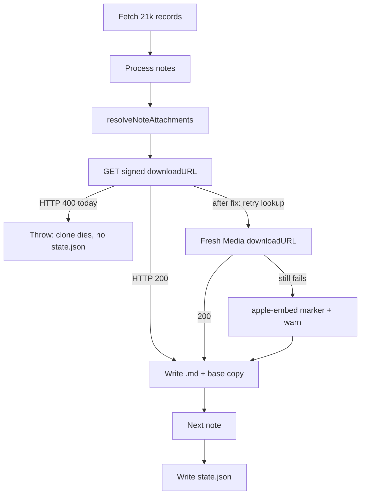

# Survive a bad attachment during clone

## What is happening

Auth and the CloudKit listing both succeeded (`Fetched 21376 record(s)`). Failure is in the **process** loop, at about note 9484/21352.

[`fetchAssetBytes`](src/cloudkit/databaseClient.ts) GETs a signed `cvws.icloud-content.com` URL. Any non-OK status throws `Attachment download failed: HTTP 400` with **no note id, attachment id, or URL**. [`runClone`](src/commands/clone.ts) has no `catch` around that, so the rest of the vault is abandoned.

That GET is an unauthenticated signed URL. The comment on `fetchAssetBytes` already says these URLs expire (`e=` query param) and the fix is to **re-lookup the Media record**, not retry the same URL. Large-note **text** assets already do that in `resolveTextAsset`; file attachments in [`resolveNoteAttachments`](src/notes/attachmentSync.ts) do not.

Missing Attachment/Media records already degrade to an `<apple-embed>` marker (Safety Guarantee). A failed **download** of an otherwise valid Asset does not — it kills the whole clone.

**Progress is not a vault.** Notes and attachments are written as they go, but [`.icloud-md/state.json`](src/notes/cloneState.ts) is written **only at the end**. Without it:

- `pull` / `status` / `push` refuse (`NotClonedDirectoryError`)
- `clone` **can** be re-run on `./my-notes` (no `state.json` → not “already cloned”)
- there is **no** `--skip`, `--resume`, or `--debug` flag
- re-clone re-fetches the zone and re-downloads every attachment (`existingAttachments` is `{}`)

Do **not** hand-write `state.json` with this run’s `syncToken`. That token covers the **full** listing; `pull` would then skip every note that never got written.



## Debug this failure right now (no code)

HTTP logging is always on.

1. Last error: `~/.config/icloud-md/last-error.json`
2. Last asset GET: `~/.config/icloud-md/debug.log` — search for `"note":"fetchAssetBytes"` with `"status":400`. The `request.url` is the signed content URL. The `lookupRecords:records/lookup` lines just above it are that note’s Attachment/Media record names (the embed UUIDs).
3. On-disk hint: completed notes already have `.icloud-md/base/<recordName>.md` and a working `.md`. The failing note was **not** written (download happens before `writeFile`). Its `attachments/` dir may contain files from earlier embeds in the same note.
4. If you file an issue: `icloud-md bug-report --since 6h --no-state` (do **not** dump the whole vault).

There is currently **no** way to skip that attachment and continue. `^C` and re-clone without a code change restarts processing from zero.

## Code change (so a re-clone can finish)

Keep this a bug fix, not a new clone-resume protocol. Incremental `state.json` with the listing’s `syncToken` would strand unprocessed notes; a separate checkpoint schema is a feature that wants a discussion first ([CONTRIBUTING.md](CONTRIBUTING.md)). The files already on disk **are** the checkpoint if we stop aborting and stop re-downloading them.

### 1. Retry file-attachment downloads with a fresh Media URL

In [`src/notes/attachmentSync.ts`](src/notes/attachmentSync.ts), wrap `fetchAssetBytes` the way [`resolveTextAsset`](src/cloudkit/databaseClient.ts) already wraps text assets:

- first GET fails → `lookupRecords` the Media record (`attachment.entry.mediaRecordName`) → parse a new `downloadURL` → GET once more
- second failure (or lookup miss) → do **not** throw; treat that embed like an unresolvable record

### 2. Degrade a persistent failure to a marker + warning

On persistent download failure:

- `replacements[index] = formatEmbedMarker(ref)` (same path as missing Media, lines 313–315)
- do **not** add it to `state.attachments`
- return a `SyncNotice` (`warn`) naming `noteRecordName`, attachment id, and HTTP status
- [`runClone`](src/commands/clone.ts) / [`runPull`](src/commands/pull.ts) already print `summary.notices`

The note still writes. `push` already requires embed markers to survive verbatim, so the hole stays read-stable.

### 3. Skip re-download when the bytes are already on disk

This is what preserves the ~9484 notes already in `./my-notes`.

`parseAssetField` currently drops `size` even though captures include it ([`noteAttachments.ts`](src/notes/noteAttachments.ts) ~241–249). Keep `size` on `AttachmentAsset`. In `resolveNoteAttachments`, if `needsDownload` and the destination file already exists with that size, skip the GET and still record the attachment entry.

Same-directory re-clone uses the same in-memory `uniqueFileName` sequence, so completed attachments land on the same paths. Rewriting the `.md` files is cheap; not re-fetching tens of MB of audio/images is the win.

### 4. Name the note in any remaining hard errors

If something still has to throw, interpolate `noteRecordName` and the attachment UUID (text-asset failures already do this).

### Tests and docs

- New tests next to [`databaseClient.assetBody.test.ts`](src/cloudkit/databaseClient.assetBody.test.ts) / [`attachmentSync.test.ts`](src/notes/attachmentSync.test.ts): expired URL → re-lookup succeeds; both GETs 400 → marker, no throw; existing file with matching `size` → no GET.
- README: short troubleshooting note under clone — one bad attachment no longer aborts; re-run `clone` on the same directory; use `--account` to skip the browser; leftover files from a failed run are reused by size.

## Finishing **this** clone after the fix

```bash
npm run build && npm link
icloud-md clone ./my-notes --account '<your Apple ID or dsid>'
```

Same directory is required (that is where the already-downloaded files are). After it completes, `state.json` exists and `pull`/`status` work. The one bad embed, if still undownloadable, will show as a warning and an `<apple-embed>` in that note.

Out of scope: writing `state.json` mid-clone, a `--skip-attachments` flag, or changing text-asset failure behavior (that still must not pass a body-less note while advancing the sync token).
