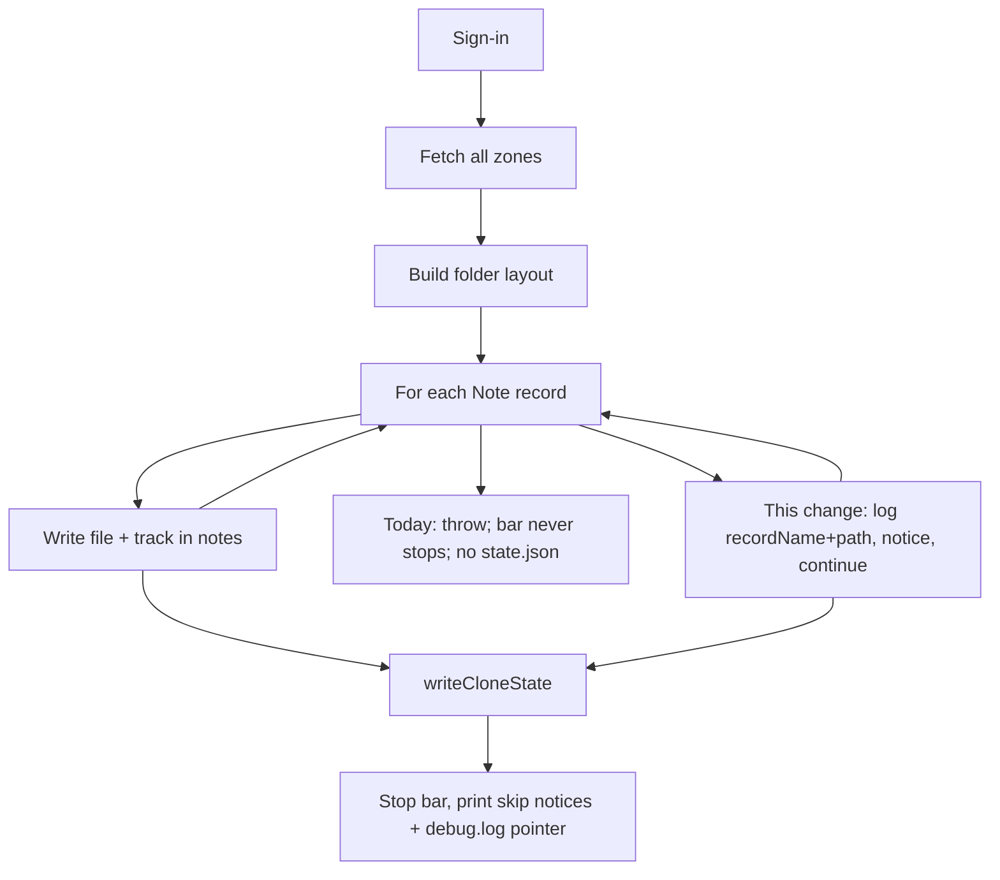

# Clone log-and-continue + debug tracing

## The problem this is solving

This is **not** a sign-in problem. Auth and the CloudKit fetch already succeeded. The failure is in the **initial clone's processing loop**: writing one note/file throws, the whole command aborts, and there is no usable vault and no easy trace of *which* note died.

Live run against `./lolinternets-icloud-notes`:

```
✔ Fetched 21410 record(s) from iCloud
Processing |…| 180/21386 notesError: ENOENT: no such file or directory, open
  '…\Notes\📚🖥Kayla's Old
   rMBP Pro ►Info (Retina, 13-inch, Early 2015).md'
    at async writeFile …
    at async runClone (…/dist/commands/clone.js:118)
```

Three compounding failures:

1. **Fail-fast after fetch.** [`runClone`](src/commands/clone.ts) wraps each record in `try`/`finally` with **no `catch`**. `writeFile` / attachment download / timestamps throwing at note 180 of 21k aborts the rest. [`writeCloneState`](src/notes/cloneState.ts) only runs after the loop, so there is no `.icloud-md/state.json` — not a vault. Markdown already written is untracked.
2. **The error is unreadable.** The throw happens *while* the cli-progress bar is still live on stderr, so the stack is concatenated onto the bar (`180/21386 notesError: ENOENT…`). `onProcessComplete` (which calls `bar.stop()`) never runs. Same class of bug as [#25](https://github.com/coddingtonbear/icloud-md/issues/25).
3. **Nothing traces the failed record.** HTTP is already always in `~/.config/icloud-md/debug.log`, but application-level write failures are not. `last-error.json` keeps only this one ENOENT path, with no CloudKit `recordName`. There is no `--debug` flag; this repo's debug channel is that log file.

The same abort also happens for a matched attachment whose CDN GET fails ([#55](https://github.com/coddingtonbear/icloud-md/issues/55), HTTP 400 on a zero-size `.drawing`). Unresolved Attachment/Media chains already degrade to an embed marker; a *matched* download that then fails is still fatal.

Deleted / undecodable notes already skip (`skippedDeleted` / `skippedUndecodable`). Unexpected I/O and download errors do not.



## Behavior

**Still abort** (no `state.json`): auth failure, zone fetch failure, folder-layout construction, or `writeCloneState` itself. Those happen *before* there is a vault to keep. Private-zone `TextDataAsset` download failure in [`inlineAssetBodies`](src/cloudkit/databaseClient.ts) stays fail-fast — that path is designed not to let a sync token move past a large note whose body never arrived.

**After a successful fetch, log and continue:**

1. **Per note** in `runClone`'s record loop: catch unexpected errors (this ENOENT included). Increment `skippedFailed`, push a `warn` [`SyncNotice`](src/progress.ts) with `record.recordName`, the intended relative path when known, and the error message. `appendDebugLog` a `clone: skipped note …` line with the same fields (and stack when present). Then process the rest. `writeCloneState` still runs with whatever `notes` / `attachments` succeeded.
2. **Per attachment file** in [`resolveNoteAttachments`](src/notes/attachmentSync.ts): wrap `fetchAssetBytes` so HTTP 400/410/network errors do not kill the note or the clone. Log `resolveNoteAttachments: couldn't download …`, replace that one embed with `formatEmbedMarker`, keep the rest of the note.

Move `Object.assign(attachments, …)` / table-attachment merges to **after** the note file and base copy succeed, so a failed write does not leave tracked attachments for an untracked note.

**Visibility (the “see what went wrong” part):**

- Do not print skip warnings mid-bar — they would mash the same way. Collect notices; `onProcessComplete` stops the bar; then [`printCloneSummary`](src/cli.ts) prints them on their own lines.
- Extend the skip line with `skippedFailed`. If any failed, one extra line pointing at `~/.config/icloud-md/debug.log`.
- Debug log lines are always-on (no new `--debug` flag, no stdout dump of every record). That is this project's debug channel.

Clone still exits 0: the vault is usable. `--json` already emits `CloneSummary` + `notices`.

**Retry limitation (document, do not add schema):** skipped notes are omitted from `state.notes` while the fetch `syncToken` is still written, so a later `pull` will not re-fetch them unless they change remotely. The warning names the record id. No `layoutVersion` bump.

Filename sanitization for this particular title is **out of scope**. The note may still be skipped; the clone must not die for it, and the skip must be greppable in `debug.log`.

## Tests and docs

- Extract `skipFailedCloneRecord` in [`src/commands/clone.ts`](src/commands/clone.ts): updates `CloneSummary` + `appendDebugLog` without rethrowing. Test in [`src/commands/clone.test.ts`](src/commands/clone.test.ts) against a temp log path: count/notice include recordName and path, log line written.
- `tryDownloadAttachmentBytes` in [`src/notes/attachmentSync.ts`](src/notes/attachmentSync.ts): stubbed throw → `undefined` + debug log; success → bytes.
- README: after sign-in, a few record/attachment write failures skip that item, still write `state.json`, and the skipped identities live in the clone summary and `debug.log`. Run `npm run toc` only if a heading is added/renamed.

Verify with `npm run typecheck`, `npm test`, `npm run build`.
