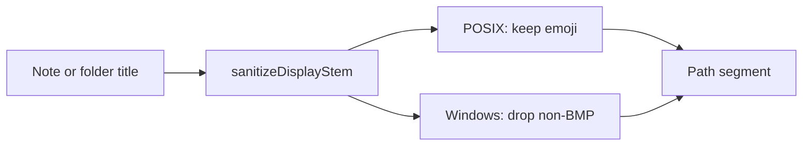

# Windows-safe emoji titles and folders

## What actually failed

The live clone died here:

```
writeFile '...\Notes\📚🖥Kayla's Old rMBP Pro ►Info (Retina, 13-inch, Early 2015).md'
Error: ENOENT: no such file or directory, open
```

This is **not** NTFS rejecting emoji. NTFS allows them. It is a **Node.js on Windows path bug** ([nodejs/node#48673](https://github.com/nodejs/node/issues/48673), [#49042](https://github.com/nodejs/node/issues/49042)): libuv's WTF-8 conversion (Node 20.4–20.11, some 21.x) turns supplementary-plane characters (surrogate pairs) into `ENOENT` on `open`/`mkdir`. The project already requires `node: ">=20"`, so those broken versions are in range.

- `📚` (U+1F4DA) and `🖥` (U+1F5A5) are supplementary-plane → they trigger the bug.
- `►` (U+25BA) is BMP → fine. BMP emoji like ☕ already pass [`titleFilename.test.ts`](src/notes/titleFilename.test.ts).
- Clone reached note 180, so **folder mkdir already succeeded**. This particular failure is a **note title** sitting in `Notes/`. An emoji **folder** title would have died earlier in the `layout.allDirs` mkdir loop ([`src/commands/clone.ts`](src/commands/clone.ts) ~150–152). Both need the same fix.

[`noteFileName`](src/notes/filename.ts) and [`sanitizeFolderDirName`](src/notes/folderTree.ts) only strip `\ / : * ? " < > |`. They keep emoji on purpose. Control characters U+0000–U+001F (except whitespace already collapsed by `\s`) are also currently kept and are illegal on Windows.

The skip-and-continue work already in `runClone` would only **omit** this note. This change is so it actually lands.

## Approach

Do **not** strip emoji on macOS/Linux (Obsidian sidebar titles, existing tests). Do **not** bump `layoutVersion` — this only changes newly derived names. Pull keeps existing folder dirs via `preferredDirNames`.

Extract one helper used by both sanitizers, with an explicit platform flag so tests are not host-dependent:

```ts
sanitizeDisplayStem(title, { windows, maxLength, stripTrailingDotSpace })
```

Default `windows` to `process.platform === "win32"`.

Windows extra pass (after taking the first line, before the existing illegal-ASCII strip):

- Drop non-BMP code points (`codePoint > 0xFFFF`).
- Drop leftover ZWJ (U+200D) and variation selectors (U+FE0E/U+FE0F) so `👨‍👩‍👧‍👦` / `🖥️` do not leave invisible junk.
- Drop C0 controls and DEL on **all** platforms (`[\u0000-\u001F\u007F]`), not only Windows — they are never valid path characters.
- Collapse whitespace, trim, then slice by **code point** (today `.slice(0, 80)` can split a surrogate pair).

The failing title becomes `Kayla's Old rMBP Pro ►Info (Retina, 13-inch, Early 2015).md`. Two emoji-only titles that collide after stripping still uniquify via existing `uniqueFileName`.



### Call sites

- [`noteFileName`](src/notes/filename.ts) — in-body display names. Title stays in the file body, so a lossy name is fine.
- [`sanitizeFolderDirName`](src/notes/folderTree.ts) — disk dir only. Remote folder title already lives in `state.folders[].name`.
- **`--filename-as-title`**: do **not** strip inside [`encodeTitleStem`](src/notes/titleFilename.ts) (that mapping is reversible). Instead, if the title has non-BMP on Windows, treat it as lossy:
  - Prefer the BMP-stripped encoded stem as the file name when that stem is still representable.
  - Record the real title in `apple-note-title` via existing [`titleNeedingFrontmatter`](src/notes/filename.ts).
  - If stripping leaves nothing (or yields `CON` / a leading dot / …), keep today's `Untitled.md` + frontmatter fallback.
  - [`fileNameCarriesTitle`](src/notes/filename.ts) already compares against `noteFileNameFor`, so a stripped name will not rename-loop on every pull.
- Attachment basenames from [`decodeAttachmentFilename`](src/notes/noteAttachments.ts) are currently unsanitized and go straight to `writeFile`. Run new names through the same Windows-safe stem (keep the extension) in [`matchAttachments`](src/notes/attachmentSync.ts) so an emoji photo name is not the next crash. Already-tracked attachment paths stay as they are.

## Tests

Force `{ windows: true }` so Linux CI covers the Windows rules.

- Exact live title: `📚🖥Kayla's Old rMBP Pro ►Info (Retina, 13-inch, Early 2015)` → `Kayla's Old rMBP Pro ►Info (Retina, 13-inch, Early 2015).md`
- Folder sanitizer: same input without `.md`; emoji-only folder → `Untitled Folder`
- Control char stripped on every platform
- `☕` (BMP) kept even on Windows
- `👨‍👩‍👧‍👦` stripped on Windows; [`encodeTitleStem`](src/notes/titleFilename.ts) still passes it through unchanged
- Filename mode on Windows: emoji title → stripped stem + `titleNeedingFrontmatter` returns the original; empty-after-strip → `Untitled.md`
- Existing illegal-ASCII, trailing-dot, and uniquify tests stay green

## Docs

In [README.md](README.md) “Where the title lives” (and a short Known limitations bullet): on Windows, supplementary-plane emoji are omitted from **file and folder names**; the title remains in the note body, or in `apple-note-title` under `--filename-as-title`. Mention that Node 20.4–20.11 cannot open emoji paths at all, which is why names are projected rather than written as-is.

No `layoutVersion` migration. No engines bump — sanitizing is what makes `>=20` actually work on Windows.

## After the change

The incomplete `lolinternets-icloud-notes` directory is not a vault (`clone` refuses an existing dir). Delete or rename it, then re-clone.

Verify with `npm run typecheck`, `npm test`, `npm run build`.
